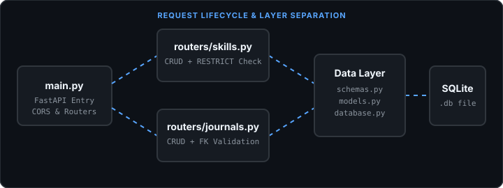
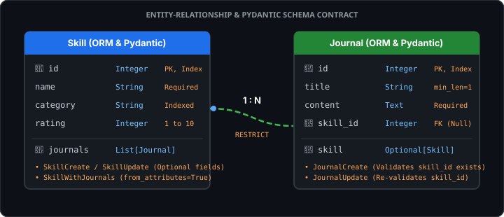
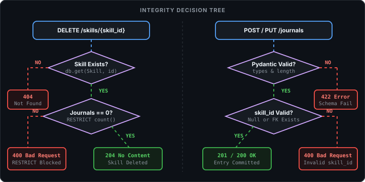

# 🎯 Skill Tracker API (v2.0)

[](https://fastapi.tiangolo.com)
[](https://www.sqlalchemy.org)
[](https://docs.pydantic.dev)
[](https://www.sqlite.org)
[](https://opensource.org/licenses/MIT)

A modular RESTful API built with **FastAPI**, **SQLAlchemy ORM**, and **Pydantic v2** for tracking technical skill progression and maintaining structured learning journals with strict relational integrity.

---

## 📑 Table of Contents

- [⚡ Quick Start](#-quick-start)
- [🏗️ System Architecture &amp; Project Skeleton](#️-system-architecture--project-skeleton)
- [🧬 Database &amp; Pydantic Schema Design](#-database--pydantic-schema-design)
- [🧭 Business Logic &amp; Validation Decision Tree](#-business-logic--validation-decision-tree)
- [🛣️ API Reference](#️-api-reference)
  - [1. Skills Endpoints (`/skills`)](#1-skills-endpoints-skills)
  - [2. Journals Endpoints (`/journals`)](#2-journals-endpoints-journals)
- [🚀 Git Deployment Checklist](#-git-deployment-checklist)
- [📜 License](#-license)

---

## ⚡ Quick Start

1. **Clone & enter the repository:**

   ```bash
   git clone <your-repo-url>
   cd skill-tracker-api
   ```

2. **Create a virtual environment & install dependencies:**

   ```bash
   python -m venv venv
   source venv/bin/activate  # On Windows: venv\Scripts\activate
   pip install fastapi uvicorn sqlalchemy pydantic
   ```

3. **Run the development server:**

   ```bash
   uvicorn main:app --reload
   ```

   - **Interactive Swagger Docs:** `http://127.0.0.1:8000/docs`
   - **ReDoc Specification:** `http://127.0.0.1:8000/redoc`

---

## 🏗️ System Architecture & Project Skeleton

The codebase strictly adheres to the **Separation of Concerns** principle—decoupling HTTP routing, request validation, ORM persistence, and database session management.

### Request Lifecycle & Layer Separation

<p align="center">
  
</p>

### Directory Structure

<p align="center">
  
</p>

---

## 🧬 Database & Pydantic Schema Design

<p align="center">
  
</p>

### Engineering & Architectural Highlights

| Pattern                | Implementation                                                | Architectural Benefit                                                                    |
| :--------------------- | :------------------------------------------------------------ | :--------------------------------------------------------------------------------------- |
| **Session Lifecycle**  | `Depends(get_db)` with `try / finally` `yield`                | Guarantees per-request SQLAlchemy session isolation and automatic connection teardown.   |
| **Eager Nesting**      | SQLAlchemy `relationship()` + Pydantic `from_attributes=True` | Resolves `Skill` + nested `List[Journal]` seamlessly in `/skills/{id}/details`.          |
| **RESTRICT Guard**     | `db.query(Journal).filter(...).count()`                       | Enforces referential integrity at `O(1)` memory overhead before deleting parent skills.  |
| **Safe Partial Patch** | `model_dump(exclude_unset=True)`                              | Prevents omitted fields in `PUT` payloads from overwriting existing columns with `None`. |

---

## 🧭 Business Logic & Validation Decision Tree

<p align="center">
  
</p>

---

## 🛣️ API Reference

### 1. Skills Endpoints (`/skills`)

| Method   | Endpoint                     | Description                                   | Parameters / Body                      | Status Codes        |
| :------- | :--------------------------- | :-------------------------------------------- | :------------------------------------- | :------------------ |
| `POST`   | `/skills/`                   | Create a new skill                            | Body: `SkillCreate`                    | `201`, `422`        |
| `GET`    | `/skills/`                   | List all skills                               | Query: `?category=Backend`             | `200`               |
| `GET`    | `/skills/{skill_id}`         | Retrieve a single skill                       | Path: `skill_id` (`int`)               | `200`, `404`        |
| `GET`    | `/skills/{skill_id}/details` | Retrieve skill with nested journals           | Path: `skill_id` (`int`)               | `200`, `404`        |
| `PUT`    | `/skills/{skill_id}`         | Partially or fully update a skill             | Path: `skill_id` · Body: `SkillUpdate` | `200`, `404`, `422` |
| `DELETE` | `/skills/{skill_id}`         | Delete skill (**RESTRICT** if journals exist) | Path: `skill_id` (`int`)               | `204`, `400`, `404` |

<details>
<summary><b>📄 View Sample Payloads for <code>/skills</code></b></summary>

#### `POST /skills/` — Request Body

```json
{
  "name": "FastAPI",
  "category": "Backend",
  "rating": 8
}
```

#### `GET /skills/1/details` — `200 OK` Response

```json
{
  "id": 1,
  "name": "FastAPI",
  "category": "Backend",
  "rating": 9,
  "journals": [
    {
      "id": 1,
      "title": "Learned routing",
      "content": "Explored APIRouter and dependency injection.",
      "skill_id": 1
    }
  ]
}
```

#### `PUT /skills/1` — Partial Update Request

```json
{
  "rating": 10
}
```

#### `DELETE /skills/1` — `400 Bad Request` (RESTRICT Triggered)

```json
{
  "detail": "Cannot delete skill because 1 journal(s) are linked to it."
}
```

</details>

---

### 2. Journals Endpoints (`/journals`)

| Method   | Endpoint                 | Description                                  | Parameters / Body                          | Status Codes               |
| :------- | :----------------------- | :------------------------------------------- | :----------------------------------------- | :------------------------- |
| `POST`   | `/journals/`             | Create a journal entry (optional `skill_id`) | Body: `JournalCreate`                      | `201`, `400`, `422`        |
| `GET`    | `/journals/`             | List all journal entries                     | Query: `?skill_id=1`                       | `200`                      |
| `GET`    | `/journals/{journal_id}` | Retrieve a specific journal entry            | Path: `journal_id` (`int`)                 | `200`, `404`               |
| `PUT`    | `/journals/{journal_id}` | Update entry & re-validate `skill_id`        | Path: `journal_id` · Body: `JournalUpdate` | `200`, `400`, `404`, `422` |
| `DELETE` | `/journals/{journal_id}` | Delete a journal entry (leaves skill intact) | Path: `journal_id` (`int`)                 | `204`, `404`               |

<details>
<summary><b>📄 View Sample Payloads for <code>/journals</code></b></summary>

#### `POST /journals/` — Request Body

```json
{
  "title": "Learned Pydantic validation",
  "content": "Today I learned how Pydantic automatically validates request bodies.",
  "skill_id": 1
}
```

_(Returns `400 Bad Request` if `skill_id` does not exist in the `skills` table.)_

</details>

---

## 🚀 Git Deployment Checklist

Before pushing to your remote repository, verify that the local SQLite database is excluded:

1. Ensure `skill_tracker.db` is listed in your `.gitignore` and not staged in `git status`.
2. Stage, commit, and push your changes:
   ```bash
   git add .
   git commit -m "Upgrade to v2.0: Replace dictionary with SQLite + SQLAlchemy"
   git push -f origin main
   ```

---

## 📜 License

Distributed under the **MIT License**. Free to use, modify, and distribute.
